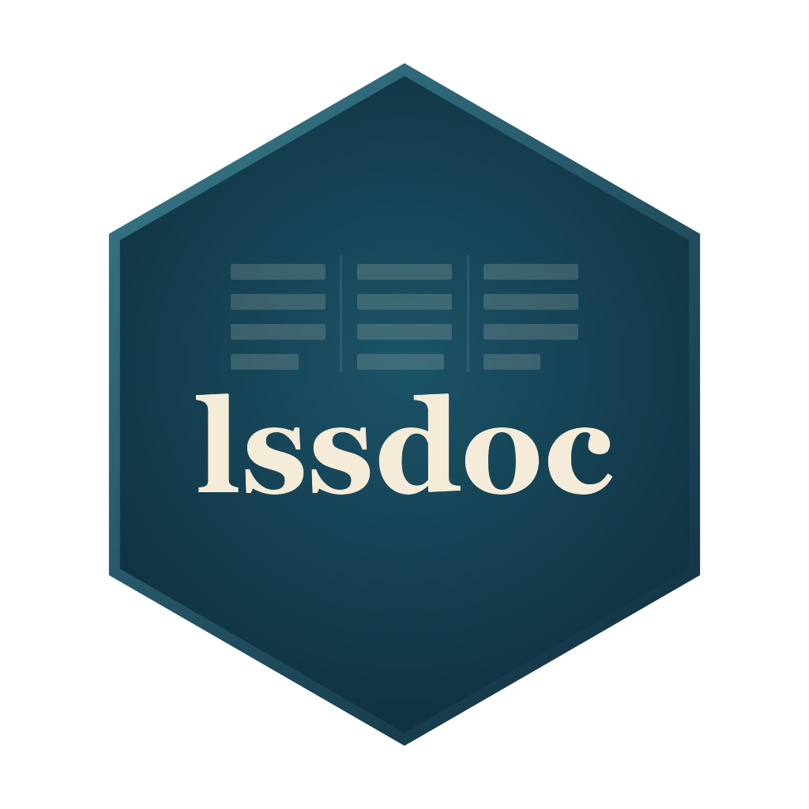
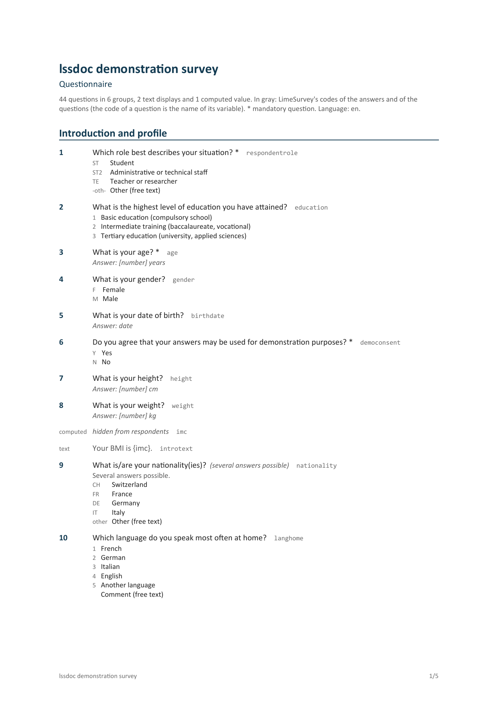
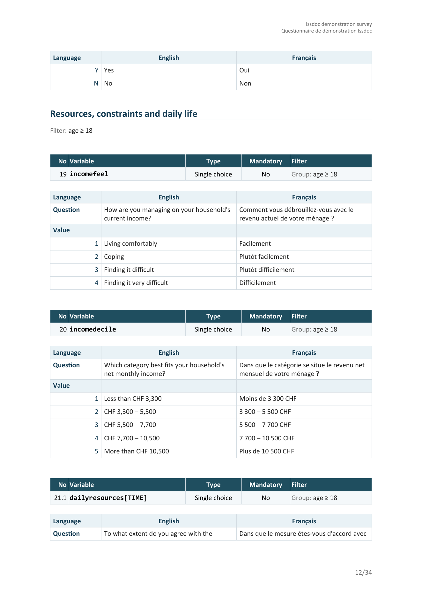
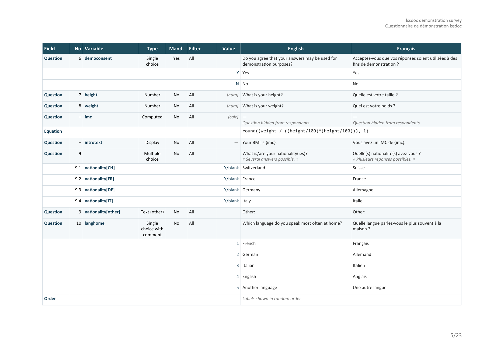

<!-- README.md is generated from README.Rmd. Please edit that file. -->

# lssdoc: LimeSurvey questionnaires to and from Word 

<!-- badges: start -->

[](https://CRAN.R-project.org/package=lssdoc)
[](https://amaltawfik.r-universe.dev/lssdoc)
[](https://github.com/amaltawfik/lssdoc/actions/workflows/R-CMD-check.yaml)
[](https://app.codecov.io/gh/amaltawfik/lssdoc)
[](https://lifecycle.r-lib.org/articles/stages.html#stable)
[](https://www.repostatus.org/#active)
[](https://opensource.org/licenses/MIT)
[](https://doi.org/10.32614/CRAN.package.lssdoc)
[](https://CRAN.R-project.org/package=lssdoc)
<!-- badges: end -->

**lssdoc** turns a LimeSurvey `.lss` export into Word (`.docx`) or PDF
documents. It is meant for the researchers and survey methodologists who
build questionnaires. The documents it produces can go as they are to
ethics committees, translators and reviewers. There are two of them.

The **questionnaire** shows the survey as a respondent reads it, in one
language: each question with its number, its text and its answer
options, one per line.



The **documentation** gives every question in full, with its variable,
its type, its filter and its attributes, in up to four languages side by
side. It also runs an automated integrity audit. It comes in two
templates:

- **`"cards"`** – one detached block per item (meta table + question
  table), stacked vertically. Closest to the printed questionnaire a
  respondent would see.

  

- **`"table"`** – one dense table covering the whole document: every
  variable is one tinted *Question* row carrying its metadata, followed
  by one or more white *Value* rows holding the answer codes and their
  labels per language. Group banners (with their description, when
  present), welcome text, survey description and end text become
  labelled rows of the same table so the document reads as a single
  artifact.

  

lssdoc also works the other way around. Write a questionnaire in a Word
form, or describe it in R, and lssdoc writes the `.lss` file you import
into LimeSurvey – so the people who design a questionnaire never have to
build it by hand in a web interface.

Other things lssdoc takes care of for you:

- **Multilingual chrome.** Column headers, row labels, type labels
  (Single choice / Multiple choice / Text / Number …), Value
  descriptors, the audit section – everything outside the survey content
  – is translated to English, French, German, Spanish or Italian.
  Independent from the survey’s content languages, so you can keep your
  FR/DE questionnaire and switch the document scaffolding to English (or
  vice versa) with a single argument.
- **Variable-centric compound rendering, matching the data file.** Every
  response variable is documented under the exact column name of the
  LimeSurvey **CSV / Excel export**, so the variable index lines up with
  the raw data file column for column: arrays and multiple choice as
  `parent[subq]` / `parent[other]`, dual-scale arrays split into one
  block per scale (`parent[subq][1]`), two-dimensional arrays as the row
  x column cross-product (`parent[row_col]`), ranking expanded into one
  column per position (`parent[answerid]`), list-with-comment into
  `parent[_Ccomment]`, and the comment of each option of a multiple
  choice with comments as `parent[subqcomment]`. Pass
  `variable_names = "underscore"` for the Expression Manager / SPSS /
  Stata code form (`parent_subq`) instead.
- **Methodological type labels.** UI distinctions like “List (radio)” vs
  “List (dropdown)” collapse into “Single choice”, because the response
  semantics are identical and the actual codes appear in the Value
  section. The Type cell reads in the methodologist’s vocabulary, not
  LimeSurvey’s.
- **Automated audit.** Missing translations, duplicate codes, forward
  references in routing filters, array-scale inconsistencies, orphan
  structural references, types missing their required options or
  subquestions – all listed in an audit section of the document. No AI;
  rule-based and reviewable.
- **Local-only processing.** No network calls, no third-party services.
  The questionnaire content never leaves the machine where R runs.

## Installation

Install the released version from CRAN:

``` r
install.packages("lssdoc")
```

Or the latest build from
[R-universe](https://amaltawfik.r-universe.dev/lssdoc) (pre-built, no
compiler needed):

``` r
install.packages(
  "lssdoc",
  repos = c("https://amaltawfik.r-universe.dev", "https://cloud.r-project.org")
)
```

Or the development version from GitHub, with **pak**:

``` r
# install.packages("pak")
pak::pak("amaltawfik/lssdoc")
```

Or with **remotes**:

``` r
# install.packages("remotes")
remotes::install_github("amaltawfik/lssdoc")
```

The package depends on **officer** and **flextable** (declared as
`Suggests` – the parse and audit paths work without them).

## Quick tour

Reading, auditing and rendering:

| Function | Role |
|----|----|
| `read_lss(file)` | Parse a `.lss` into a structured `lss` object. |
| `audit_lss(input)` | Inspect a survey for anomalies; returns an `lss_audit` object with a `print()` method. |
| `render_questionnaire(input, output, ...)` | Render the questionnaire as it reads, in one language, to a Word or PDF document. |
| `render_documentation(input, output, ...)` | Render the full documentation of the survey to a Word or PDF document. |
| `render_audit(input, output, ...)` | Render the audit findings alone to a Word or PDF document. |

Writing a questionnaire (experimental):

| Function | Role |
|----|----|
| `lss_template_docx(path, lang)` | Write a blank Word form to fill in. |
| `check_form_docx(path)` | Report every problem in a filled form, in one pass. |
| `read_form_docx(path)` | Read a filled form back into a specification. |
| `lss_spec(title, groups, ...)` | Describe a questionnaire directly in R instead. |
| `as_lss_spec(lss)` | Turn a survey read with `read_lss()` into a specification. |
| `write_form_docx(x, path, lang)` | Render a specification, or an existing survey, as the form. |
| `write_lss(spec, file)` | Write a specification as an importable `.lss` file. |

`audit_lss()` and the three `render_*()` functions accept `input` as
either a path to a `.lss` file or a pre-parsed `lss` object. The output
format of the renderers is inferred from the extension of `output`
(`.docx` or `.pdf`).

### One line per document

``` r
library(lssdoc)

# The questionnaire as it reads, in the base language of the survey
render_questionnaire("survey.lss", "questionnaire.docx")

# Its full documentation, all languages side by side
render_documentation("survey.lss", "documentation.docx")
```

Each call parses the `.lss` and writes the Word document. The
documentation uses the `"cards"` template by default, with `chrome_lang`
following the survey’s primary content language. Open
`documentation.docx` in Word and click **Yes** when prompted to update
fields (page numbers and the table of contents). The questionnaire opens
without that prompt.

### The questionnaire, one language at a time

``` r
lss <- read_lss("survey.lss")

# One file per language
render_questionnaire(lss, "questionnaire_fr.docx", language = "fr")
render_questionnaire(lss, "questionnaire_de.docx", language = "de")

# The copy a respondent reads: no codes, no hidden questions
render_questionnaire(lss, "respondent_fr.docx", language = "fr",
                     show_codes = FALSE)

# Swiss French for Word's spelling checker and hyphenation
render_questionnaire(lss, "questionnaire_fr.docx", language = "fr",
                     proofing_lang = "fr-CH")
```

The codes of LimeSurvey are printed in small gray type next to what they
name. The code of a question is the name of its variable. The question
numbers are those of the documentation, so “question 12” is the same
question in both documents.

### Table layout

``` r
render_documentation(
  "survey.lss",
  "review.docx",
  languages   = c("en", "fr"),
  template    = "table",
  chrome_lang = "en"
)
```

`languages` controls which content columns appear and in which order. A
group heading and its entry in the table of contents print the name of
the group in the first of these languages that has one. `chrome_lang` is
independent of `languages`: keep `chrome_lang = "en"` to get English
column headers and row labels even if your survey content runs in French
and German – pass `chrome_lang = "fr"` (or `"de"` / `"es"` / `"it"`)
when you want the scaffolding to follow the content.

### Ethics committee submission

``` r
render_documentation(
  "survey.lss",
  "ethics_review.docx",
  languages              = c("en", "fr"),
  template               = "table",
  chrome_lang            = "en",
  show_privacy_settings  = TRUE,   # anonymized / save partial / IP / referrer / timestamp
  show_admin_settings    = TRUE,   # alias / end URL / active
  authors = list(
    list(name        = "Jane Doe",
         affiliation = "HESAV",
         orcid       = "0009-0001-2345-6789"),
    list(name        = "John Doe",
         affiliation = "HESAV",
         orcid       = "0009-0002-3456-7890")
  ),
  description = paste0(
    "Validated as part of the SNSF project XYZ. ",
    "Reference: https://example.org/projects/xyz"
  )
)
```

The cover page picks up the authors block (with clickable ORCID
hyperlinks), the description (with URLs auto-detected and made
clickable), and the privacy / admin settings rows in the metadata table.

### Just the variables

``` r
render_documentation(
  "survey.lss",
  "minimal.docx",
  template         = "table",
  show_welcome     = FALSE,
  show_endtext     = FALSE,
  show_description = FALSE,
  show_groups      = FALSE,
  show_toc         = FALSE,
  show_audit       = FALSE,
  show_index       = FALSE
)
```

Pure data: one row per variable header, one row per value code, nothing
else.

### Parse once, render many

``` r
# Parse a single time, then audit and render different variants
# without re-reading the .lss.
lss   <- read_lss("survey.lss")
audit <- audit_lss(lss)
print(audit)  # console summary of flagged anomalies

render_questionnaire(lss, "questionnaire_en.docx", language = "en")
render_questionnaire(lss, "questionnaire_fr.docx", language = "fr")
render_documentation(lss, "documentation.docx")
render_audit(lss, "qa_followup.docx")
```

### See the audit in action

A deliberately flawed survey ships with the package, so you can see what
`audit_lss()` catches without supplying your own file:

``` r
demo <- system.file("extdata", "audit_demo.lss", package = "lssdoc")
audit_lss(read_lss(demo))
#> -- lssdoc audit ----------------------------------------------------
#> 12 findings: 5 errors, 7 warnings, 0 notes.
#> x Survey: duplicate question code 'age'
#> x Question 'age': filter references 'income', asked later (forward reference)
#> x Answer 'X': points to a question id that does not exist
#> x Subquestion 'orphan_sq': points to a question id that does not exist
#> x Question 'blank_q': text empty in every language
#> ! Question 'satisf': expects answer options, but none are defined
#> ! Question 'income': text missing in 'fr'
#> ! Question 'comment ': code carries whitespace
#> ... plus an empty group name, missing subquestions and an array-scale mismatch.
```

### PDF output

``` r
# Same call, just pass a .pdf path. The package writes the .docx
# into a temp file and converts it locally via LibreOffice
# (must be installed and on PATH).
render_questionnaire("survey.lss", "questionnaire.pdf")
render_documentation("survey.lss", "documentation.pdf", template = "table")
render_audit("survey.lss", "qa.pdf")
```

## Write a questionnaire in Word

Many questionnaires are written by people who live in Word, not in R.
Hand them a blank form, get it back filled in, and turn it into a
LimeSurvey file.

``` r
# 1. a blank form, in the language of your choice
lss_template_docx("questionnaire.docx", lang = "fr")

# 2. the author fills it in, in Word

# 3. check it, then read it
check_form_docx("questionnaire.docx")   # every problem at once
spec <- read_form_docx("questionnaire.docx")

# 4. write the file to import into LimeSurvey
write_lss(spec, "questionnaire.lss")
```

The form is one small table per survey, group, question and quota,
carrying the fields each question type needs with its defaults already
filled in. Blank forms can also be [downloaded from the
website](https://amaltawfik.github.io/lssdoc/), so an author who does
not use R never has to install anything.

An existing survey can enter the same loop: `write_form_docx()` renders
it as the form, so a questionnaire can be exported from LimeSurvey,
edited in Word and re-imported. See `vignette("write-in-word")` for the
conventions, the question types and the filter syntax.

## Templates and palette

The rendered `.docx` uses an editorial petrol-blue palette tuned for
publication-grade output (`#133B52` primary, `#3A7C8C` accent, `#E9F2F6`
and `#F4F8FA` for tinted bands, `#D3DCE2` for the soft grid). Calibri
body / Consolas monospace by default; the `font` and `font_code`
arguments accept any string to override.

## Citation

Run `citation("lssdoc")` for the up-to-date citation, or cite as:

    Tawfik A (2026). _lssdoc: 'LimeSurvey' '.lss' Questionnaires to and
    from Word Documents_. doi:10.32614/CRAN.package.lssdoc
    <https://doi.org/10.32614/CRAN.package.lssdoc>. R package version
    0.3.0.9000, <https://CRAN.R-project.org/package=lssdoc>.

## License

MIT. See [`LICENSE`](LICENSE) for the full notice.
