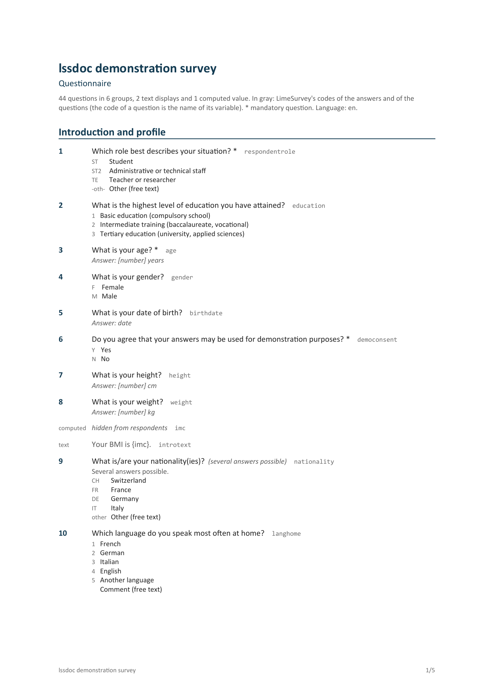
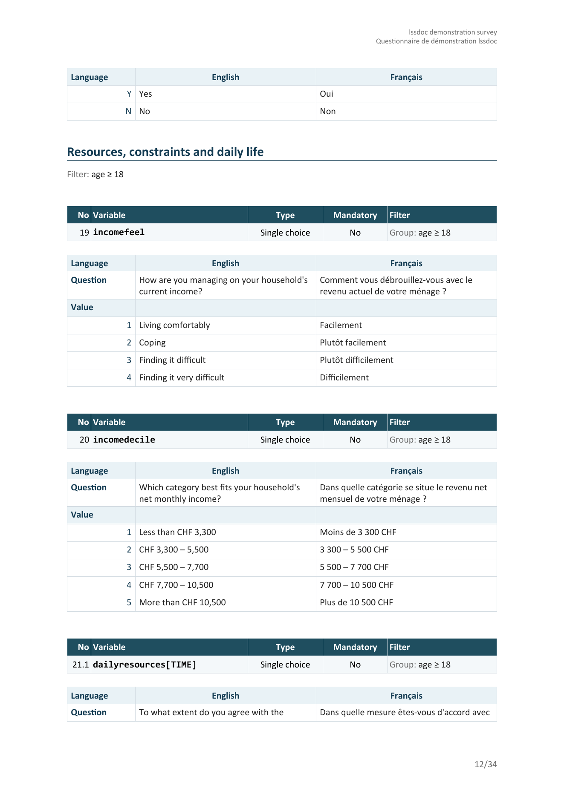
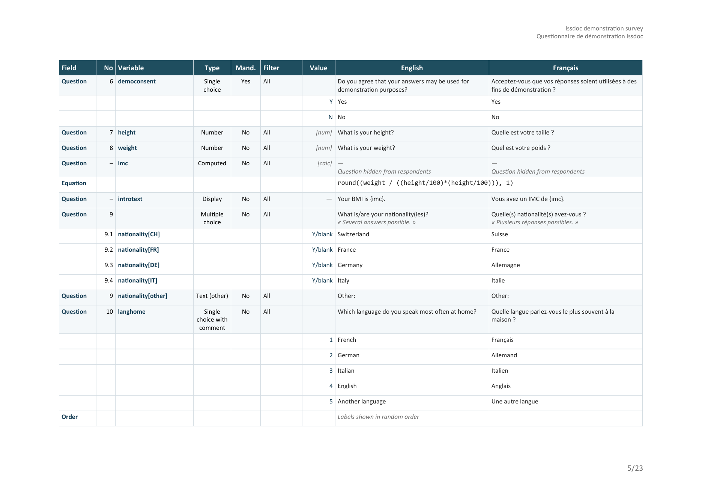

```{r, include = FALSE}
knitr::opts_chunk$set(
  collapse = TRUE,
  comment = "#>"
)
library(lssdoc)
```

**lssdoc** turns a LimeSurvey `.lss` export into Word (`.docx`) or PDF
documents: the questionnaire as a respondent reads it, in one language,
and its full documentation, with up to four languages side by side. It
also runs a rule-based audit of the survey. Everything stays on your
machine.

This vignette covers five functions:

| Function | Role |
|----------|------|
| `read_lss(file)` | Parse a `.lss` into a structured `lss` object. |
| `audit_lss(input)` | Inspect a survey for anomalies. |
| `render_questionnaire(input, output, ...)` | Render the questionnaire as it reads, in one language. |
| `render_documentation(input, output, ...)` | Render the full documentation of the survey. |
| `render_audit(input, output, ...)` | Render the audit findings alone. |

This vignette uses the demo survey that ships with the package -- a
synthetic four-language questionnaire (English, French, German, Spanish)
with quotas, a consent block and conditions on a group, a question and
subquestions.

```{r}
demo <- system.file("extdata", "demo_survey.lss", package = "lssdoc")
```

## Parse

`read_lss()` reads the `.lss` (XML) export into a structured object,
preserving every user-entered string verbatim.

```{r}
lss <- read_lss(demo)
lss$languages
```

## Audit

`audit_lss()` flags reviewable anomalies -- missing translations,
duplicate codes, forward filter references, array-scale inconsistencies,
orphan references -- as a classed object with a `print()` method. The demo
survey is clean; a deliberately broken fixture is included to show the
output:

```{r}
broken <- system.file("extdata", "audit_demo.lss", package = "lssdoc")
audit_lss(read_lss(broken))
```

## Render the questionnaire

`render_questionnaire()` writes the questionnaire as a respondent reads
it, in one language: each question with its number and its text, then its
subquestions and its answer options, one per line. The output format is
inferred from the file extension (`.docx` or `.pdf`). Rendering uses the
suggested package **officer**.

```{r, eval = FALSE}
# Parse once (above), then render without re-reading.
render_questionnaire(lss, "questionnaire.docx")
```

```{r, echo = FALSE, out.width = "100%"}

```

The codes of LimeSurvey are printed in small gray type next to what they
name. The question numbers are those of the documentation described
below.

### Useful arguments

- `language`: the language to render, one per document. The base language
  of the survey by default.
- `show_codes`: `FALSE` removes the codes, and with them the questions
  that LimeSurvey hides from respondents.
- `show_help`, `show_toc`, `show_description`, `show_welcome`,
  `show_consent`, `show_endtext`: what surrounds the questions. All are on
  by default.
- `max_options`: the number of options a long list of answer options is
  cut down to (default `12`).
- `proofing_lang`: the language declared to Word for its spelling checker
  and its hyphenation, e.g. `"fr-CH"`.

```{r, eval = FALSE}
render_questionnaire(
  lss, "questionnaire_fr.docx",
  language   = "fr",
  show_codes = FALSE
)
```

## Render the documentation

`render_documentation()` writes the full documentation of the survey:
every question with its variable, its type, its filter and its
attributes, in up to four languages side by side. Rendering uses the
suggested packages **officer** and **flextable**.

```{r, eval = FALSE}
render_documentation(lss, "documentation.docx")
```

Two templates are available. The **`"cards"`** template (default) stacks
one block per item:

```{r, echo = FALSE, out.width = "100%"}

```

The **`"table"`** template is one dense table covering the whole
document -- one row per variable, with its value codes beneath:

```{r, eval = FALSE}
render_documentation(lss, "documentation.docx", template = "table")
```

```{r, echo = FALSE, out.width = "100%"}

```

### Useful arguments

- `languages` -- which content columns appear, and in which order
  (`c("en", "fr")`); the first is the primary language.
- `chrome_lang` -- language of the *document chrome* (column headers, row
  labels, type labels), independent of the content languages.
- `template` -- `"cards"` (default) or `"table"`.
- `variable_names` -- `"brackets"` (default) reproduces the LimeSurvey
  CSV/Excel export column names, so the variable index matches the raw
  data file; `"underscore"` uses the SPSS/Stata code form.
- `base_size` -- body type size in points (default `10`); raise it
  (e.g. `12`) for a roomier single-language render.
- `page_format` -- `"auto"`, `"A4-portrait"`, `"A4-landscape"` or `"A3"`.

```{r, eval = FALSE}
render_documentation(
  lss, "review_en_fr.docx",
  languages   = c("en", "fr"),
  template    = "table",
  chrome_lang = "en"
)
```

## PDF output

Pass a `.pdf` path: the package writes a `.docx` to a temporary location
and converts it locally via LibreOffice (which must be installed and on
the `PATH`). No upload, no network call.

```{r, eval = FALSE}
render_questionnaire(lss, "questionnaire.pdf")
render_documentation(lss, "documentation.pdf")
```

## Audit-only document

`render_audit()` produces a focused QA document -- the cover page, then one
section per severity -- separate from the documentation.

```{r, eval = FALSE}
render_audit(lss, "qa.docx")
```
